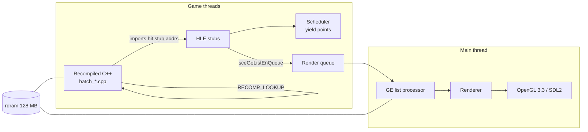

# Architecture

Structural reference for psprecomp. For project status, build instructions, and limitations,
see [README.md](README.md).

## Contents

- [System Overview](#system-overview)
- [Rust Crates](#rust-crates)
- [Generated Output Layout](#generated-output-layout)
- [Per-Game Layer (games/)](#per-game-layer-games)
- [Runtime Subsystems](#runtime-subsystems)
- [Code Overlays (banks)](#code-overlays-banks)
- [Key Data Flow](#key-data-flow)
- [Invariants and Conventions](#invariants-and-conventions)

## System Overview

Two halves: a Rust recompilation pipeline (offline) and a C++17 runtime (online).

1. **Analyze** — Ghidra headless (`analysis/ExtractAnalysis.java`) exports functions, xrefs, and
   mid-function entry points; the Rust ELF parser adds imports (NIDs), relocations, and section
   data. Merged into `analysis.json` (all addresses as hex strings). Relocatable PRX modules
   (`e_type 0xFFA0`) are first rebased to `PSP_USER_MODULE_BASE` (0x08804000; `--load-base`
   to override) with their Type-A relocation tables applied; ET_EXEC binaries load where
   linked and skip every PRX-only step. For **both** formats, analyze emits a `module{}`
   facts block (SceModuleInfo name + gp, entry = load_base + e_entry, text extent per
   PPSSPP `ElfReader` semantics) — the runtime's boot constants flow from it (issue #47
   Phase 2). PRX inputs additionally record `prx{load_base}` provenance.
2. **Recompile** — each guest function is decoded into a typed IR and emitted as a C++ function;
   batches are emitted in parallel (rayon). Output also includes the dispatch table, data
   sections, and mid-entry wrappers.
3. **Run** — the generated code is compiled into the runtime, which supplies guest memory, a
   cooperative scheduler, HLE stubs for the firmware imports, and the GE→OpenGL renderer.

## Rust Crates

All under `crates/`:

| Crate | Responsibility |
|-------|----------------|
| `psp-parser` | ELF/PRX parsing (goblin 0.9.3); PRX loading: segment rebase to `PSP_USER_MODULE_BASE`, section-first Type-A relocation discovery + PPSSPP-faithful application (`reloc.rs`), `LoadedImage` virtual-address view (`image.rs`), SceModuleInfo lookup (`prx.rs`), libstub import walking + NID resolution (`imports.rs`, `nid.rs`) |
| `psp-ir` | `MipsOp` enum, `DecodedFunction` — typed IR for all Allegrex + FPU instructions |
| `psp-decoder` | MIPS32 + Allegrex + FPU instruction decoding, two-pass delay-slot reordering; a branched-into delay slot (BIDS, #56) is fused at the branch (`BranchHazardDelay`) and duplicated at the slot's own position (`DelaySlotRejoin`) so back-edges into the slot keep hardware semantics |
| `psp-optimizer` | Peephole passes; all disabled by default (`OptimizerConfig::default()` all false) |
| `psp-emitter` | C++ code generation, batch emission (rayon), dispatch table, generated CMakeLists; a function body whose end is reachable (last op is not an unconditional control transfer — the function-granularity sibling of BIDS) gets an explicit fall-through tail `RECOMP_LOOKUP(end_vaddr); return;` so execution continues into the next function instead of silently returning; mutually exclusive with the reconstructed terminal-`jal` epilogue, which synthesizes the downstream teardown instead |
| `psp-cli` | `psprecomp` binary with `analyze`, `recompile`, `dump` subcommands |

## Generated Output Layout

`psprecomp recompile` writes to `output/` (gitignored; always regenerated, never hand-edited):

| Path | Contents |
|------|----------|
| `generated/batch_*.cpp` | Per-batch function translations |
| `dispatch.cpp` | Address-to-function dispatch table |
| `data_sections.cpp` | `.data`/`.rodata`/`.bss` as byte arrays (addresses masked with `0x07FFFFFFU`); with `[image] source = "disc"`, only the expected PT_LOAD table + FNV-1a-64 and a call into `runtime/src/psp_eboot_loader.cpp`, which reads, decrypts (vendored PPSSPP `PrxDecrypter`, `runtime/third_party/kirk/`) and checks the boot file at boot. The runtime adds its `include/` to the recomp target for that header |
| `init_array.cpp` | Static-constructor pointer table (not walked by default — the game's CRT handles it) |
| `mid_entries.cpp` | Mid-function entry point wrappers |
| `patch_sets.cpp` | Opt-in `[[patch_sets]]` of the manifest: each patched function re-emitted from the patched bytes as `<name>__ps_<set>` (plus mid-entry wrappers and code caves outside the image as `PATCH_<set>_<addr>`), and the `recomp_patch_set_count/_name/_enable` API that registers a set over the dispatch table. Always emitted (empty API without sets); main output only — bank code is not patchable yet |
| `syscall_table.cpp` | Generated NID import binding table (issue #40): one `RecompNidStub` row per analysis.json `imports[]` entry (stub address, NID, resolved name, library), sorted by stub address, header stamped with the analysis.json sha256. The runtime's `psp_hle_init()` binds HLE handlers by name at these stub addresses (decls: `runtime/include/hle/psp_hle_imports.h`; emitter: `crates/psp-emitter/src/syscall_table.rs`; recompile **hard-errors** on an empty `imports[]`) |
| `funcs.h` | Forward declarations for all generated functions |
| `include/recomp.h` | `recomp_context` struct, register aliases, memory macros, `RECOMP_LOOKUP` declaration |
| `CMakeLists.txt` | Generated build fragment — globs `batch_*.cpp` only; defines `{module_name}_recomp` plus the stable alias `psp::recomp` |
| `recompile_report.json` | Silent-path audit: counts, decode errors, unresolved NIDs, unhandled relocations, dispatch-target audit, dedup renames (schema in `crates/psp-cli/src/report.rs`; usage in DEBUGGING.md "#37") |
| `fingerprint.json` | Build fingerprint: content hash of the codegen-determining Rust sources + analysis.json hash + `cross_mid` flag + counts. Verified at runtime CMake configure by `runtime/cmake/check_fingerprint.py` — stale output/ fails configure (recipe in `crates/psp-cli/src/fingerprint.rs`; usage in DEBUGGING.md "#36") |
| `include/recomp_fingerprint.h` | Generated header with the fingerprint hash/flag/timestamp; `runtime/src/main.cpp` prints it as the first boot line |
| `include/recomp_module.h` | Generated module facts (issue #47 Phase 2): `RECOMP_MODULE_NAME/ENTRY/GP/TEXT_START/TEXT_SIZE`, `RECOMP_SEG0_VADDR/MEMSZ`, `RECOMP_HEAP_BASE`, `RECOMP_CTOR_COUNT/FIRST_CTOR` — sourced from analysis.json `module{}`; the runtime boot path hard-includes it (emitter: `crates/psp-emitter/src/module_header.rs`; recompile **hard-errors** when analysis.json lacks `module{}` — see DEBUGGING.md "#47 P2") |
| `include/recomp_game_config.h` | Generated per-game choices (issues #46/#47 Phase 4): `RECOMP_GAME_ID`, `RECOMP_BOOT_PATH`, `RECOMP_HEAP_OVERRIDE`, `RECOMP_ASSET_LAYER_BND` — sourced from the `--config` manifest (`games/<id>/game.toml`); generic no-op defaults when recompile ran without `--config`. The runtime guards the include (pre-Phase-4 outputs still build) and never parses TOML (emitter: `crates/psp-emitter/src/game_config_header.rs`) |

Every recompiled function has the signature
`void(uint8_t* rdram, recomp_context* ctx)` (`FuncPtr` in `recomp.h`). The FPU register file in
`recomp_context` exposes `float f[32]` and `uint32_t fi[32]` as aliasing views of the same
storage via an anonymous union.

### Runtime ↔ output contract (issue #47 Phase 1)

The runtime selects its output directory through the CMake cache variable
`PSPRECOMP_OUTPUT_DIR` (default `../output`, validated at configure time alongside the
issue #36 fingerprint check) and links the stable target `psp::recomp` — an ALIAS the
generated `CMakeLists.txt` defines for `{module_name}_recomp`. The runtime therefore
never hardcodes a game's module name or output path; building against another game is
`cmake -B build-<game> -S runtime -DPSPRECOMP_OUTPUT_DIR=/abs/path/<game>_output`.
Runtime hooks that wrap specific guest functions resolve them through the dispatch table
at boot (`RECOMP_LOOKUP` against the pristine table) instead of `extern FUN_*`
declarations, so no game-specific symbols are required at link time.

Per-game boot constants travel the same channel (issue #47 Phase 2): the runtime
hard-includes the generated `recomp_module.h` for the module name/entry/GP, text range,
first load segment, heap base (16 MB-aligned bump-heap start, policy P11; a manifest
`[module] heap_base` pin overrides via `RECOMP_HEAP_OVERRIDE`) and the boot probes —
runtime sources carry no game-specific addresses for these.

## Per-Game Layer (games/)

Issue #46 / #47 Phase 4: a game is described by **facts** (analysis.json → generated
headers, automatic) plus **choices and workarounds** (curated), and the curated layer
lives entirely under `games/<id>/`:

| Artifact | Consumed by | Carries |
|----------|-------------|---------|
| `games/<id>/game.toml` | `psprecomp recompile --config` | `[recompile]` force entries / force mid-entries (replaces the former hardcoded consts), top-level stubs/skips/patches, opt-in `[[patch_sets]]` (alternate bodies the runtime swaps in with `PSPRECOMP_PATCHES`), and `[game]`/`[boot]`/`[module]`/`[runtime]` choices emitted into `recomp_game_config.h` (the runtime never parses TOML) |
| `games/<id>/runtime/*.cpp` | runtime build via `-DPSPRECOMP_GAME=<id>` | Address-keyed dispatch hooks, allocator/CRT override bodies, boot/thread context tweaks, asset layer, IO policy, LOOKUP_MISS handler, GE vertex fallback — everything title-specific that is code, not data (Patapon: `hooks_main/_memory/_thread/_dispatch/_io/_ge.cpp` + `asset_bnd.cpp/.h`; private decls in `patapon_hooks.h`) |
| `games/<id>/tests/`, `games/<id>/scripts/` | manual / CI | Game-coupled unit tests (`test_asset_bnd`, built only under `-DPSPRECOMP_GAME=patapon`) and acceptance scripts (`test_phase11_*.sh`) |

The seam is `PspGameModule` (`runtime/include/psp_game_module.h`): one struct of
registration hooks (`register_hooks` after `psp_hle_init()`, `on_boot_context` just
before `entry()`, `on_thread_start` after each thread's k0 block is built). Exactly one
translation unit provides the strong `psp_game_module()` definition: the selected game
module, or `runtime/src/psp_game_default.cpp` (no-op module, id `""`) when
`-DPSPRECOMP_GAME=none`. Selection is compile-time (CMake glob of
`games/<id>/runtime/*.cpp` with `CONFIGURE_DEPENDS`) — no plugin machinery, and a
generic build verifiably contains zero game symbols (`nm | grep`). The default is
`patapon` so the documented build commands keep working unchanged; at boot the runtime
warns loudly when the compiled-in module id differs from the output dir's
`RECOMP_GAME_ID`. Reasoning: bring-up of a second game must not inherit Patapon's patch
stack, and a fix that only works for one title belongs in its module, never in core.

Beyond the `PspGameModule` boot hooks, the core exposes narrow installer seams a game
module may use from `register_hooks` (issue #47 Phase 5 — each replaced formerly inline
Patapon code; all default to no-op when uninstalled):

| Seam | Header | Generic default |
|------|--------|-----------------|
| `psp_kmem_set_partition_alloc_observer` / `psp_kmem_bump_alloc` / `psp_kmem_reserve_remaining` | `hle/psp_hle.h` | Bump heap untouched by games except through these |
| `psp_dispatch_set_miss_handler` | `hle/psp_hle.h` | Miss = log + `v0 = 0` noop stub |
| `psp_kernel_set_callback_dispatch_observer` | `hle/psp_hle_kernel.h` | No per-callback diagnostics |
| `psp_io_set_policy` (`PspIoPolicy`) | `hle/psp_hle_io.h` | No archive reroute / slot staging / artifact filter; slice-fd mechanics stay in core |
| `ge_vertex_set_degenerate_fallback` | `psp_ge_vertex.h` | World-space passthrough + one-time warn |

The quarantine is enforced mechanically by `runtime/tools/purity_gate.sh` (see
DEBUGGING.md §2): no non-allowlisted `0x08xxxxxx`/`0x09xxxxxx` literal in
`runtime/src` + `runtime/include`, and no game symbol (defined or undefined) in any
core object file of a build.

Opt-in patch sets (`[[patch_sets]]`): a named group of instruction words and code caves,
for patches a player chooses at run time, such as a community 60 fps cheat. The recompiler
emits each affected function twice (unpatched in the batches, patched in `patch_sets.cpp`);
`PSPRECOMP_PATCHES=<name>` makes `psp_patch_sets_apply()` register the patched bodies over
the dispatch entries right after the table is built, before the HLE layer and the game
hooks wrap entries, so a set that is not named costs nothing and changes nothing. Patches
whose effect needs host help pair with the game module through `psp_patch_set_active()`
(Patapon 3: the `60fps` set doubles the frame rate, and the module paces the game's input
update to 30 Hz with `VblankPacer`, because the game counts key repeat and held time in
frames; it also blends each character pose from the two whole frames around the motion
clock, since the GMO evaluator rounds to whole frames and the doubled rate would show each
pose twice, while its own interpolate flag mixes rounded and interpolated channels into poses
the game never shows (the blend covers the keyed bone alpha too, which fades
the hideout's place halo and the Hero Gate's sparkles), and blends the bone matrices that part-built units hang their parts on, since baked skeletons
store one bone matrix per whole frame, and the GE lists those models record per frame for their
own parts (a blended copy in a guest-memory ring is called instead, `psp_ge_list_blend.h`), also for the
FEVER worm, whose motion player lives in a code overlay (the hook on that overlay address resolves the
loaded bank's function per call and checks its code, `psp_code_match.h`, since other overlays share the
window), and for the chest room's reward halo, drawn by another function of that overlay at its own
clock (each scope kind lists which model words take which clock word); and it runs each weather object's update (rain drops,
wind) at most once per two vblanks with the skipped call's frame time handed to the next run,
`PacedStepTable` in `psp_paced_step.h`, because those updates time their spawns with the frame
time but move every particle by a fixed step per call; so the weather still moves every
frame, rain drops are drawn half a step ahead on the frames in between, `psp_particle_nudge.h`,
and the wind ribbons step every frame with their per-call advance halved; the script
objects run their script VM the same way, since scripts wait in frames and move props such as
the hideout's Silver Hoshipon by a fixed step per run, and the 3D nodes a script moved are
built half a step ahead on the frame in between, `psp_half_ahead.h`). Reasoning: cheats patch guest RAM, but recompiled code never reads instruction
words, so the patched words have to become code at recompile time; keeping both bodies
leaves the default build byte-identical.

Zero-manifest defaults: no `--config` ⇒ no force entries, generic boot path, heap from
the `RECOMP_HEAP_BASE` align policy, no asset layer; `-DPSPRECOMP_GAME=none` ⇒ no hooks.
A well-behaved game boots this way — the manifest exists for curation, not table stakes.

## Runtime Subsystems

All under `runtime/` (headers in `runtime/include/`, sources in `runtime/src/`):

| Subsystem | Files | Responsibility |
|-----------|-------|----------------|
| Boot / main loop | `main.cpp` | Generic boot sequence (module start, thread creation), SDL2 main loop — contains zero address-keyed hooks (they live in `games/<id>/runtime/`, Phase 4) |
| Boot image | `psp_eboot_loader.cpp`, `third_party/kirk/` | `[image] source = "disc"` (per game, ET_EXEC only): the main memory image is not compiled in. At boot the loader reads the boot file from disc0, decrypts a `~PSP` file in memory (PPSSPP `pspDecryptPRX`) or takes a plain ELF as is, checks the PT_LOAD layout and the FNV-1a-64 against the recompiled image and copies it to `rdram`; any mismatch prints `[EBOOT] ...` and exits with code 11 before a window opens. Why: the exe no longer carries the game's bytes — the player's own disc supplies them — and the wrong disc for an exe stops cleanly instead of booting a broken game |
| Game modules | `psp_game_module.h`, `psp_game_default.cpp`, `games/<id>/runtime/` | Per-game hook seam — see [Per-Game Layer](#per-game-layer-games) |
| Memory | `psp_memory.cpp` | 128 MB `rdram` allocation; all guest addresses masked with `0x07FFFFFFU` |
| Dispatch | `psp_dispatch.cpp` | `RECOMP_LOOKUP` address→function resolution; miss handler (consults overlay banks first); `PSPRECOMP_STRICT` abort mode |
| Overlay banks | `psp_overlay.cpp`, `psp_overlay.h` | Registry of self-registered overlay banks; resolves overlay-window addresses against the bank whose MWo3 id is loaded, after a once-per-activation code hash check — see [Code Overlays](#code-overlays-banks) |
| Scheduler | `psp_scheduler.cpp` | Cooperative threading (`PspThread`, yield points); `thread_local PspThread* g_current` |
| HLE | `src/hle/psp_hle_*.cpp` | Firmware NID implementations: io, kernel (thread/sema/mutex/lwmutex/eventflag/memory), display, ge, ctrl, power, utility; name-based registration wired to the generated `syscall_table.cpp` stub addresses via dispatch overrides (issue #40 — no per-game stub addresses in the runtime; unbound stubs get a loud per-NID unimplemented no-op that returns a deterministic `v0 = 0`; NID→stub lookup for runtime code via `psp_hle_stub_addr_for_nid`) |
| Audio output | `psp_audio_mixer.cpp`, `psp_audio_out.cpp` | Per-channel PCM FIFOs (8 sceAudio channels + Output2) mixed with saturation into an SDL2 44.1 kHz stereo device. The `sceAudio*Blocking` HLE queues guest PCM and paces the caller on the real drain (yield + short sleep, bounded wait); without a device (`PSPRECOMP_NO_AUDIO`, headless) it paces on a per-channel virtual drain clock (`psp_time.cpp`): each grain is scheduled one playback duration after the previous one, so per-grain guest work is absorbed like a real device's drain instead of slowing the stream. `PSPRECOMP_AUDIO_DUMP` records the mix to WAV |
| SAS | `hle/psp_sas_core.cpp`, `hle/psp_hle_sas.cpp` | Pure SAS synthesizer ported from PPSSPP (VAG decode, ADSR, pitch, PCM voices, reverb); the HLE renders each grain into the game's buffer, which the game then plays through sceAudio |
| ATRAC | `third_party/at3_standalone/`, `hle/psp_atrac_ctx.cpp`, `hle/psp_hle_atrac.cpp` | Vendored LGPL ATRAC3/ATRAC3plus decoder plus a pure context ported from PPSSPP's AtracCtx2 (RIFF parse, streaming buffer, loops); `sceAtrac*` HLE on top |
| Interrupts / vblank | `psp_subintr.cpp`, `hle/psp_hle_intr.cpp`, `psp_vblank_clock.h` | Sub-interrupt handler table (register/enable, PPSSPP error codes). A drift-free 60000/1001 Hz clock drives `sceDisplayWaitVblankStart` (blocks to the next boundary), `sceDisplayGetVcount`, and the once-per-frame dispatch of enabled `PSP_VBLANK_INT` handlers on the waiting thread with the register file preserved. A game module can request display fast-forward (`psp_fast_forward.h`, used by Patapon 3 while its "CARGANDO" icon shows): skipped vblank waits move the clock to the vblank instead of sleeping, presents drop to one per real frame and thread delays to 1 ms, so frame-paced loaders run at host speed; it lapses a few vblanks after the requests stop and is blocked while an ad hoc session is up (`sceNetAdhocctlInit`..`Term`), because peers and network timeouts count real time |
| Wall clock (RTC) | `psp_rtc.cpp`, `hle/psp_hle_utility.cpp` | The `sceRtc*`/libc time readers report the host clock, or a fixed base that keeps advancing in real time when `PSPRECOMP_RTC_FIXED=YYYY-MM-DDTHH:MM:SS` is set (strict ISO parse, civil↔unix µs — pure, unit-tested). Patapon reads the clock once at boot and the hideout sky/lighting follows it, so scripted visual tours taken at different host hours diverge past the regression gate; the pinned clock makes captures reproducible at any host time |
| Savedata | `hle/psp_savedata.{h,cpp}` | `sceUtilitySavedata` back end behind the utility-dialog status machine in `psp_hle_utility.cpp`. Pure and unit-tested (`tests/test_savedata.cpp`): reads/writes the guest `SceUtilitySavedataParam` through a bounds-checked view of `rdram` and keeps saves on the host as `<root>/<gameName><saveName>/` (data file, real PSF `PARAM.SFO`, icon/pic/snd files; atomic temp-file+rename writes). Root = `$PSPRECOMP_SAVEDATA` else `./SAVEDATA`. Saves are written in plaintext; encrypted saves (PPSSPP / PSP, `SAVEDATA_PARAMS` non-zero) are decrypted on load with the request key through `hle/psp_save_crypt` (PPSSPP's sceChnnlsv cipher vendored in `third_party/kirk`). Ported from PPSSPP `SavedataParam.cpp` (GPL-2.0-or-later); no dialog UI, so list modes auto-pick (`PSPRECOMP_SAVE_SLOT` chooses the entry `LISTLOAD` loads; the launcher's Saves screen sets it) |
| Gamedata install | `hle/psp_gamedata_install.{h,cpp}` | `sceUtilityGamedataInstall` back end behind the same utility-dialog status machine in `psp_hle_utility.cpp`. Pure and unit-tested (`tests/test_gamedata_install.cpp`): a chunked copy engine moves every file of `<disc0>/PSP_GAME/INSDIR/` into `<root>/<gameName><dataName>/` (same root as savedata, PPSSPP destination naming) across Update calls — 20 × 32 KiB per step so progress advances without blocking — then writes a merged `PARAM.SFO` with the shared PSF writer. `ms0:/PSP/SAVEDATA/` is mounted onto the savedata root in `psp_hle_io.cpp` (case-insensitive prefix; other `ms0:` paths stay unmounted), and `sceIoDevctl("ms0:"/"fatms0:", 0x02425818/0x02425823)` reports the same virtual 4 GB card the savedata SIZES path uses. Ported from PPSSPP `PSPGamedataInstallDialog.cpp` / `sceIo.cpp` (GPL-2.0-or-later); no install animation |
| Movies (sceMpeg) | `hle/psp_psmf.cpp`, `hle/psp_mpeg_demux.cpp`, `hle/psp_media_engine.cpp`, `hle/psp_hle_mpeg.cpp` | PSMF header parser; MPEG-PS demuxer with an H.264 access-unit splitter and ATRAC3plus frame extractor (PPSSPP MpegDemux); decoders: H.264 through FFmpeg libavcodec + libswscale (optional, `PSPRECOMP_FFMPEG_DIR` at configure time; without it each AU counts as a frame so movies still time out and end) and movie audio through the vendored ATRAC3plus decoder. `sceMpegRingbufferPut` runs the game's read callback (a guest function, invoked like the vblank sub-interrupt handlers) and feeds the packets to the demuxer; `packetsAvail` tracks the bytes the video path has not consumed. Ported from PPSSPP `sceMpeg.cpp` / `MediaEngine.cpp` (GPL-2.0-or-later); hleDelayResult timing is not reproduced. `tests/test_hle_mpeg.cpp` plays a whole real movie through the handlers |
| GE list processor | `psp_ge.cpp` | Display-list interpretation, including SIGNAL flow-control behaviors 0x10–0x12 (JUMP/CALL/RET) |
| Renderer | `psp_ge_draw.cpp`, `psp_ge_vertex.cpp`, `psp_ge_patch.cpp`, `psp_ge_texture.cpp`, `psp_ge_texdecode.cpp`, `psp_ge_shader.cpp`, `psp_gl_state.cpp`, `psp_texrep*.cpp` | Vertex decode/transform (column-major PSP matrices), BEZIER surface tessellation (SPLINE not yet), texture decode (pure, unit-tested: buffer-width stride, swizzle, CLUT transform) and GL texture cache (slot pick — a resident exact match wins over eviction holes — pure in `include/psp_ge_texcache.h`, unit-tested; XXH3 content-hash memo, once per display list by default with an opt-in doubling re-hash window, in `include/psp_ge_texmemo.h`, unit-tested), optional texture replacement from PPSSPP-format packs (PPSSPP-identical keys, background PNG decoding, one GL texture per pack file shared across cache slots — `include/psp_texrep_share.h`, unit-tested), shaders, GE stencil on a host stencil buffer (register mapping, 5551 rules and clear-mode stencil ported from PPSSPP, pure in `include/psp_ge_stencil.h`, unit-tested), GE fog (factor `(view z + FOG1) * FOG2` per transformed vertex in `ge_transform_vertices`, carried in `PackedVertex::fog`, mixed toward FOGCOLOR in the fragment shader; never on through-mode draws; PPSSPP semantics, pure in `include/psp_ge_fog.h`, unit-tested), GL draw (through a shadow of the tracked GL state — binds/blend/depth/stencil/cull/program/uniforms are re-issued only when they change; pure policy in `include/psp_gl_shadow.h`, unit-tested), — deep-dive in [docs/GRAPHICS.md](docs/GRAPHICS.md) |
| Texture patches / button prompts | `psp_ge_texpatch.cpp`, `psp_prompt_atlas.cpp`, `psp_prompt_patcher.cpp`, `psp_prompts.cpp`, `psp_prompt_raster.cpp`, `psp_input_device.cpp`, `assets/button_prompts/` | A seam in `ge_texture_bind`: a patcher a game module registers recognises a texture by content (decoded once per content hash, returning a *tag* 1..255 that tells `apply` which version of the texture it is, e.g. its language) and reports a *variant* latched at each display-list start; the variant is mixed into the texture-cache hash, so every variant is composed once on a cache miss — on the decoded original enlarged to the render scale, or on the HD-pack image — and then cached (no per-frame cost, no half-updated frame). Its one user is the button-prompt patcher, one seam patcher holding up to eight prompt atlases (the recognition tag packs the atlas index and its own tag, index * 32 + tag, which still fits the seam's 8-bit tag, so the first-registered atlas keeps its tags): the game describes each atlas (size, a recognition region, the cell of each PSP glyph — Patapon 3: the help bar, the mission command list and the four drum-hit words, `games/patapon3/runtime/p3_prompts.cpp`; a spec may give its cells an opaque background, filled before the icon is drawn, so a symbol redrawn inside an opaque disc leaves no hole) and the runtime redraws the cells with the key / Xbox / DualShock 4 / DualSense icon of the action's mapped button (`ControlMap` reverse lookup) for the device of the last input (`psp_input_device.h`; debug socket `P <device>`). Icons: Kenney Input Prompts 1.5 (CC0), embedded in the exe at build time (`cmake/embed_files.cmake`). The same composition redraws the atlas's labels sharp (`psp_bar_text.cpp`, `stb_truetype_impl.cpp`, `assets/fonts/`): a second coverage signature over the label area picks the language's word table (game data, `games/patapon3/runtime/p3_prompt_labels.cpp` and `p3_command_labels.cpp`; the recognition tag carries it to `apply`), and each transcribed word is redrawn with the embedded Zen Maru Gothic Bold (SIL OFL 1.1) at its original box and baseline, condensed only when too wide; an unknown label signature keeps the game's labels. The variant is icons flag + device/style | text flag (`PSPRECOMP_BUTTON_ICONS=off`, `PSPRECOMP_BAR_TEXT=off`). Pure parts unit-tested |
| Render queue | `psp_render_queue.cpp` | Condvar request queue — the only path by which GL work reaches the main thread |
| Event loop | `psp_event_loop.cpp` | SDL2 event pump, quit handling, render-queue drain |
| Input | `psp_controls.cpp`, `psp_event_loop.cpp` | Keyboard keys and gamepad buttons to PSP buttons from `PSPRECOMP_CONTROLS` (settings.ini `[controls]`, resolved by `psp_settings.cpp`); a pure `ControlMap` replaces the two fixed switches. Defaults equal the pre-`[controls]` tables; a key or button bound to two actions keeps the first one and logs the drop, invalid / reserved entries fall back per action. Fixed: left stick analog, LT / RT = L / R, wheel = D-pad. Contract: `docs/contracts/settings-v1.md` |
| On-screen keyboard | `psp_osk_keyboard.cpp`, `psp_osk_skin.cpp`, `psp_osk_overlay.cpp` | Steam Deck style grid (`OskKeyboard`: letters / symbols layers, shift / caps, accents, cursor keys) driven by fixed positional gamepad buttons while a `sceUtilityOsk` request is open; keyboard and pad edit the `OskSession` text at its cursor. The overlay draws the text box and grid on the main GL thread; colours, radius, gap and the optional font come from a skin JSON (`PSPRECOMP_OSK_SKIN`, shipped in `runtime/assets/osk_skins/`, copied to `build/rtw/skins/osk/`), with a symbol-font fallback for glyphs the main font lacks |
| Settings / launcher contract | `psp_ini.cpp`, `psp_settings.cpp`, `psp_menu_prompt.cpp`, `psp_exit.h` | First thing in `main()`: `--settings <path>` (else `settings.ini` next to the executable, else nothing) is parsed (pure, unit-tested) and each known key is turned into the `PSPRECOMP_*` variable the runtime already reads, only when that variable is not set yet, so every existing option reader stays unchanged and env-driven runs (bat files, tours) behave as before; `[game]` keys come from the per-game catalog `games/<id>/game_options.json` copied next to the executable, so the core has no game knowledge. `--log` redirects stderr. F1 / Select+Start held 1 s opens a "back to the menu?" prompt (pure state in `psp_menu_prompt`, drawn by `psp_osk_overlay`); Yes sets the process exit code to 10 (`psp_requested_exit_code`), which the launcher reads. Contract: `docs/contracts/settings-v1.md` |
| VFPU | `psp_vfpu_*.cpp` | VFPU instruction implementations (arith, convert, matrix, mem, trig, misc) |
| Asset/BND | `games/patapon/runtime/asset_bnd.cpp` | Patapon BND archive parsing (`DATA_CMN.BND`) — lives wholly in the Patapon game module (#47 Phase 5), reached from core only through the `PspIoPolicy` seam; arena constants in `games/patapon/runtime/asset_bnd.h` |
| Debug socket | `psp_debug_socket.cpp` | TCP server on port 9999, multiple concurrent clients, OK/ERR-framed line protocol: memory read/write, runtime-info JSON, button injection, screenshots (serviced by the render thread). Protocol reference: DEBUGGING.md §6 |
| Ad hoc networking | `src/net/`, `include/net/`, `hle/psp_hle_net.cpp`, netconf in `hle/psp_hle_utility.cpp` | PSP ad hoc play carried over a PRO ad hoc server (PPSSPP's protocol, TCP 27312), so the port can meet PPSSPP players. Pure, unit-tested parts: `adhoc_config` (server, nickname, persisted MAC, port offset from `PSPRECOMP_ADHOC_*`), `pro_protocol` (packet codec), `netconf_adhoc` (dialog decisions). `pro_client` keeps the server connection on its own host thread (login, 2 s ping, peer table); `adhocctl` is the `sceNetAdhocctl` state machine and handler registry; handler events run as guest code on one runtime thread with its own guest stack (`guest_callbacks`, like GE callbacks). `tools/adhoc_server.py` is a minimal server for tests. Data: `pdp` (UDP) and `ptp` (TCP) sockets peer to peer, or, with `PSPRECOMP_ADHOC_RELAY`, through an aemu_postoffice relay (`relay_protocol` pure codec, `relay_conn` TCP sessions; `tools/postoffice_server.py` for tests); `matching` is the sceNetAdhocMatching state machine over PDP. Ported from PPSSPP `sceNetAdhoc.cpp`, `proAdhoc.cpp`, `sceNetAdhocMatching.cpp`, `PSPNetconfDialog.cpp` (GPL-2.0-or-later); the relay protocol is reimplemented from its description. Spec `docs/superpowers/specs/2026-10-10-adhoc-multiplayer-design.md`, relay plan `docs/superpowers/plans/2026-10-11-adhoc-relay.md` |
| Guest CPU lock | `psp_cpu.cpp`, `psp_cpu.h` | One host thread runs recompiled guest code at a time — see [Guest CPU lock](#guest-cpu-lock-psp_cpu) |

### Guest CPU lock (`psp_cpu`)

The PSP runs one thread at a time. Games rely on that (allocators, task lists
and loaders without locks). Guest threads here are host threads, so letting
them run recompiled code truly in parallel produced nondeterministic races.
`psp_cpu` is the token that restores the single-core rule: only the host
thread that holds it runs guest code. `PSPRECOMP_NO_CPU_LOCK=1` disables the
lock (free-threaded, for A/B comparison).

Waiters are ordered by PSP priority (lowest number first), then by order
(-1 = back from a non-blocking HLE call, 0 = front, used by a thread returning
from an HLE call; 1 = back), then by ticket. A non-blocking HLE call gives the
token back but leaves a reservation with a 2 ms TTL
(`psp_cpu_release_reserved`): only a thread of strictly better priority may take
the CPU until this thread blocks for real or the reservation ages out, so a
lower-priority thread cannot slip in during the call. `psp_cpu_block_begin`
drops the reservation at a real wait. A caller that comes back while its
reservation is still live never lost the CPU on the PSP, so it re-acquires at
order -1, ahead of every equal-priority waiter: an equal-priority thread that
queued during the call (held back by the reservation) would otherwise be the
head, asleep, and the caller would wait for it to wake up — a timer tick per
hand-off, which stalled the main thread behind Patapon 3's two audio threads
(60 fps hitches, 2026-10-21). Diagnostics: `PSPRECOMP_CPU_SLOW`,
`PSPRECOMP_CPU_TRACE` (DEBUGGING.md).

`psp_cpu_yield_if_contended` is the preemption point. Generated loop back-edges
call `sched_preempt` (`runtime/src/psp_scheduler.cpp`), which calls it
unconditionally (the `PSPRECOMP_PREEMPT` flag gates only the extra cooperative
yield). If a waiter of better or equal priority is queued, the holder releases
and re-acquires at the back. It returns immediately when nobody of better or
equal priority is waiting.

A wait that lasts more than 5 s prints once, to stderr:
`[CPU] thread N (prio P) waited 5 s for the CPU held by thread H`
(`H` is the holder id, or `-2` when the lock is free and a reservation is what
blocks). That means the owner never reached an HLE call or a loop back-edge.

Who takes and drops the token:

- `PspCpuAcquireScope` around guest code entered from the host: thread entry
  (`psp_scheduler.cpp`), `module_start` (`main.cpp`), vblank sub-interrupt
  handlers (`psp_hle_intr.cpp`), kernel callbacks
  (`psp_hle_kernel_thread.cpp`), the sceMpeg ringbuffer callback
  (`psp_hle_mpeg.cpp`), and the GE FINISH and SIGNAL callbacks (`psp_ge.cpp`).
- `PspCpuReleaseScope` around every HLE call (`hle_cpu_wrapper` in
  `psp_hle_dispatch.cpp`): release with a reservation on entry, re-acquire at
  the front on return.
- `psp_cpu_block_begin` at real waits: `sceDisplayWaitVblankStart`,
  `sceKernelDelayThread`, semaphore / mutex / lwmutex / event-flag waits, and
  the audio blocking paths in `psp_hle_utility.cpp`.

Shutdown closes the token (`psp_cpu_close`). After that, every acquire, and a
holder's contended back-edge, parks its host thread for good, so no guest code
runs while the host tears down. Guest threads are never joined: a PSP game
does not end its threads, and the old one-by-one join with a 2 s timeout cost
about 15 s per exit. `main` then:

1. waits for the last holder (`psp_cpu_wait_released`, 1 s);
2. waits for host file writes in flight (`psp_host_io.h`: savedata, `sceIoWrite`,
   data install, ad hoc MAC; 10 s), so a save is never cut halfway;
3. tears down audio, the GE draw state and SDL;
4. ends with `quick_exit(0)`: no static destructors run under the parked
   threads, but exit-time diagnostics registered with `psp_on_exit`
   (`psp_exit.h`: GE summary, lookup-miss dump) still print.

The window is hidden as soon as quit is requested. The closing thread never
parks: if it asks for the CPU after close, it exits the process. The log shows
each step as `[RT] shutdown +<ms>ms <stage>`.

## Code Overlays (banks)

Some titles (Patapon 3) load extra code at run time: overlay files that all
load into one fixed window of guest memory (Patapon 3: `OL_*.bin`, "MWo3"
header, window `0x08ABB180..0x08BC6480`). Each overlay is recompiled as a
**bank**:

1. `scripts/overlay_elf.py` builds a *combined* ELF — the main EXEC image with
   one overlay filled into its window (the ELF's empty overlay section and
   PT_NULL placeholder become real data / PT_LOAD) — so the unchanged
   `analyze` pipeline sees the overlay code where the game runs it.
2. `recompile --bank <name>` (with `[overlays] window` in the manifest) keeps
   only the window's functions, forces the MWo3 constructor-table entries,
   wraps all generated code in `namespace <name>` (banks reuse addresses) and
   emits `bank_dispatch.cpp`: an address table plus a `PspOverlayBank` record
   (`recomp.h`) that self-registers at static init. The bank is a CMake OBJECT
   library so the registration object is always linked. It also writes
   `main_entries.json`: main-side addresses only overlay code reaches.
3. The main recompile drops the window (BSS in the main image) and imports
   every bank's `main_entries.json` (`--extra-entries`): gap addresses become
   functions, addresses inside a main function become its mid-entries.
4. At run time a main-dispatch miss inside a window goes to
   `psp_overlay_resolve`: the bank whose id matches the MWo3 header in memory
   answers, after its code ranges (functions Ghidra found + constructors,
   clipped to the file) hash to the value recorded at build time. A mismatch
   aborts with an explicit message — stale code never runs. The runtime CMake
   rejects banks whose fingerprint or `recomp.h` differs from the main output.

## Key Data Flow

- Guest code calls firmware imports through stub addresses in the binary; the dispatch table
  overrides those addresses with HLE functions.
- GE display lists are submitted by HLE (`sceGeListEnQueue`) and executed on the main thread via
  the render queue — game threads never call GL directly (macOS requirement).
- Mid-function entries (jump targets inside a function, e.g. from vtables or cross-function
  branches) are handled by wrappers that set `ctx->entry_point`; the parent function's entry
  switch dispatches to the matching label and clears the field before the goto.

## Invariants and Conventions

These are load-bearing; violating them causes real bugs.

1. `rdram` is **not** a `recomp_context` field — it is a separate function parameter
   (thread-safety: each game thread has its own context but shares memory).
2. All guest memory accesses mask addresses with `0x07FFFFFFU` (128 MB space).
3. GL calls only ever happen on the main thread via the render queue.
4. Cross-function branches use `RECOMP_LOOKUP`, never `goto` (C++ goto cannot cross function
   boundaries). Branch/jump IR stores absolute u32 target addresses, not raw offsets.
5. The generated CMakeLists globs `batch_*.cpp` only — never `generated/*.cpp` (stale duplicates
   cause linker errors).
6. Never edit `output/generated/*.cpp` by hand — fix the emitter and regenerate.
7. Duplicate function names are deduplicated with `_ADDR` hex suffixes (ODR safety); the module
   start function is named `entry`.
8. Float registers are written as `ctx->f[N]` (array notation); the `f[]`/`fi[]` union keeps
   integer and float views coherent.
9. Decode errors emit empty stubs with error comments rather than aborting the pipeline. Before
   stubbing, a function whose undecodable words are unreachable from its entry and mid-entries
   (code followed by data, e.g. a mod code cave) is cut to its reachable prefix
   (`psp_decoder::reachable_len`); an indirect `jr` other than `jr $ra` disables the cut.
10. Optimizer passes stay disabled until the project's correctness bar is met.
11. `PSPRECOMP_CROSS_MID=1` enables cross-function mid-jump injection in the recompiler
    (`crates/psp-cli/src/recompile.rs`); the project's standard workflow sets it for both the
    recompile step and runtime runs.
12. The canonical binary image is psp-parser's rebased + relocated `analysis.json segments[]`
    (`data_b64`) — everything downstream (recompile byte slicing, binary scans, data sections,
    the runtime) consumes only it. Ghidra is an *analysis oracle* (functions/xrefs/constructors),
    never a byte source: for relocatable modules its feed is pinned
    (`-loader PspElfLoader -loader-imagebase <hex>`), and a mandatory byte-equality gate
    (per-block SHA-256 from `ExtractAnalysis.java`, recomputed in analyze over the relocated
    segments) hard-fails the run if the two relocation engines (`reloc.rs` vs ghidra-allegrex)
    ever diverge. Reasoning: two independent relocation engines exist by design — the gate makes
    drift loud at analyze time instead of surfacing as translation bugs. The
    `<output>.ghidra_raw.meta.json` sidecar (binary hash, loader, imagebase) prevents a stale
    base-0 Ghidra cache from being silently reused. Details: DEBUGGING.md "#52".
13. Guest code runs only while its host thread holds the CPU lock; real waits call
    `psp_cpu_block_begin`; HLE calls release through the scopes.
